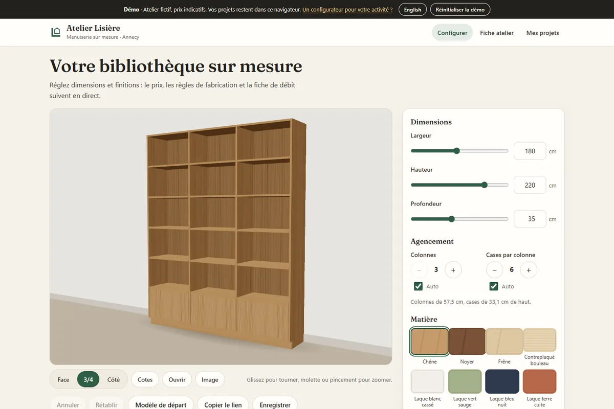
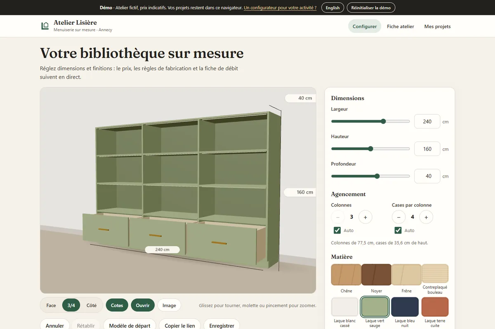
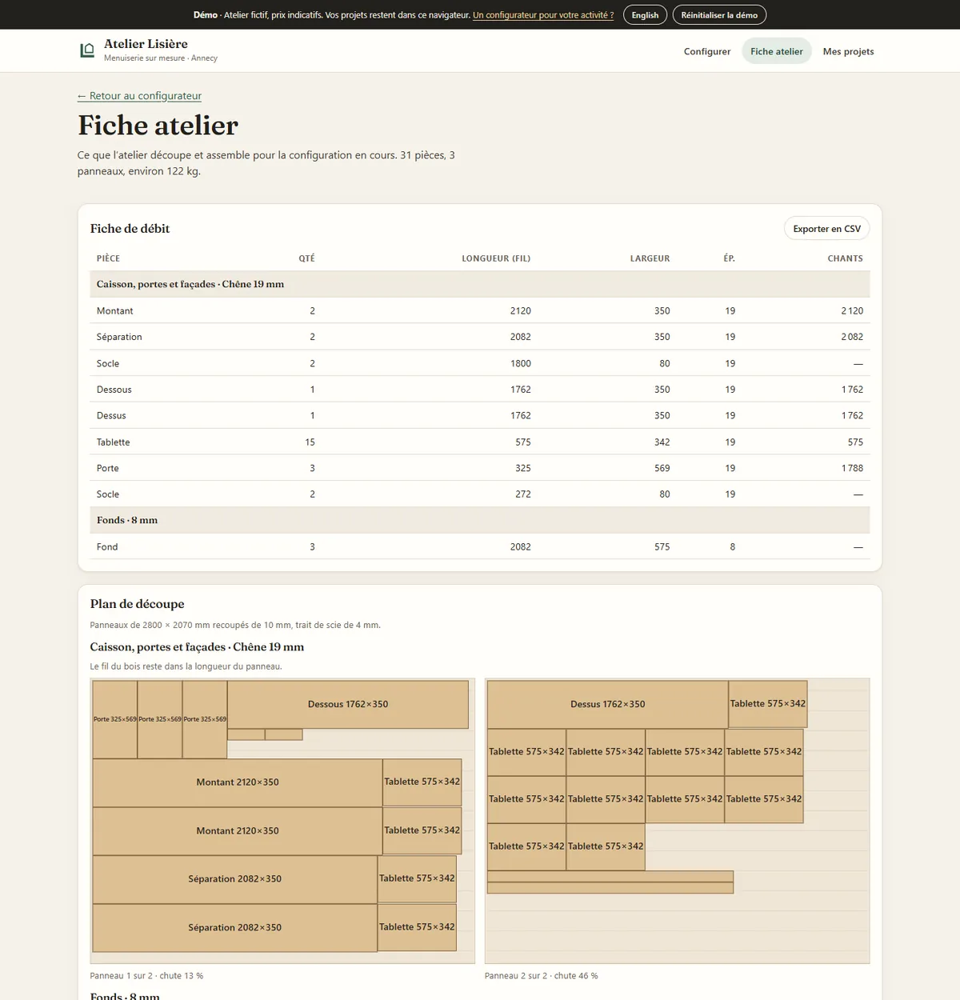
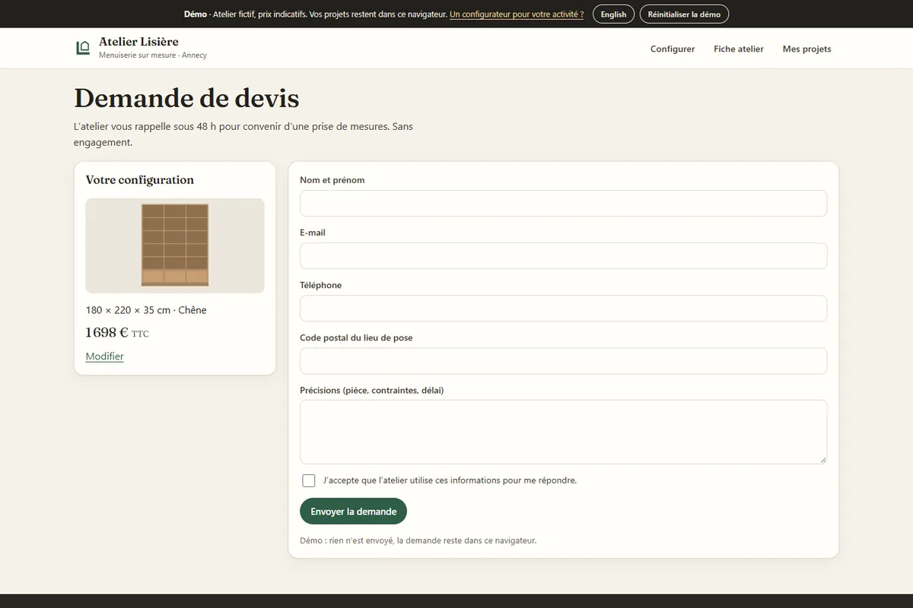
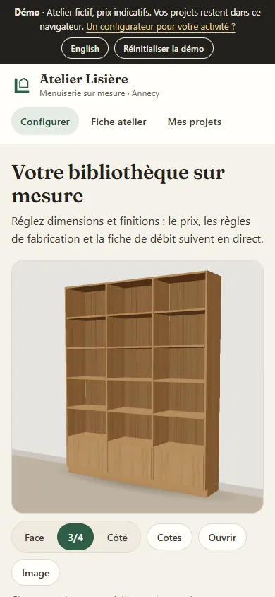
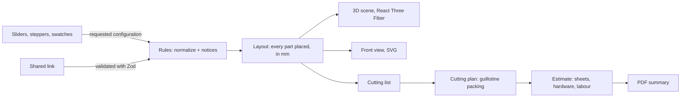

# Atelier Lisière · made-to-measure bookcase configurator in 3D (demo)

[](https://github.com/Barkatzineddine/demo-configurateur/actions/workflows/ci.yml)
[](https://barkatzineddine.github.io/demo-configurateur/)

[](LICENSE)

A configurator for a fictional joinery workshop in Annecy: the customer sets the size, layout, material and options of a made-to-measure bookcase and sees it in **3D**, with the **price**, the **workshop's construction rules** and the **cutting list** following live. Behind the picture is real joinery logic: shelves that would sag get an extra divider, tops longer than a sheet are made in two pieces, and every piece is placed on standard sheets by a **cutting-plan optimiser** that respects the wood grain. The customer can share a link, save designs, and send a quote request that comes with a **PDF summary**. French interface with an English switch, installable, works offline.

**Live: <https://barkatzineddine.github.io/demo-configurateur/>** The workshop, prices and contact details are fictional.



## Try it in two minutes

1. **Drag the width** to 250 cm: a fourth column appears and a notice explains why (three columns would make 81 cm shelves, which sag under books). At 320 cm the top comes in two pieces joined over a divider.
2. **Pick walnut, drawers and LED lighting**: the 3D view, the price and its breakdown follow. Click **Open** to pull the drawers out, **Dimensions** for the measurements, **Image** to save a PNG.
3. Open the **Workshop sheet**: the cutting list, and each sheet of oak drawn with the pieces cut from it.
4. **Copy the link** and open it in another tab: the same bookcase. Undo and redo with Ctrl+Z.
5. **Request a quote**: the form checks each field, the request gets a number, and the PDF summary downloads with the cutting list.

## Features

**Configurator**
- Width 60 to 320 cm, height 60 to 260 cm, depth 25 to 50 cm; columns and compartments chosen by the rules or set by hand; eight materials (oak, walnut, ash, birch plywood, four lacquers); open bottom row, doors or drawers; handles; plinth, back panel, LED lighting, installation.
- **3D view** built from the layout itself (one box per part, no model files to download): orbit with bounds (never behind the wall or under the floor), front, 3/4 and side views for keyboard users, doors that swing on their hinge side and drawers that slide out, dimension lines, PNG export. Wood grain is drawn on a canvas and follows each piece's grain direction.
- **Live estimate** from what the workshop actually buys and does: whole sheets taken from the cutting plan, edge banding by the metre, hinges, handles, runners, LED strips and drivers, labour per piece and per column, delivery and installation; with VAT, lead time and weight.
- **Construction rules with explanations**: maximum shelf span, minimum column width and compartment height, doors only on a tall enough row, tops longer than a sheet split over a divider, wall fixing advice and a tip-over warning for tall, shallow units, two-person delivery above 60 kg.
- **Shareable link** (the whole configuration in the address), undo and redo, saved designs with their drawing.

**Workshop and quote**
- **Cutting list**: each piece once with its quantity, length along the grain, width, thickness and edging; CSV export.
- **Cutting plan**: guillotine packing onto 2800 × 2070 mm sheets with trimmed edges and a 4 mm saw kerf. Veneer keeps its grain along the sheet; lacquered MDF pieces may turn. Several sort orders and cutting directions are tried and the plan with the fewest sheets wins.
- **Quote request** with field checks, an anti-spam guard, a yearly reference (`AL-2026-0001`) and a two-page **PDF** made in the browser: front view, specification, priced estimate, notices, then the cutting list. [Sample PDF](docs/exemple-recapitulatif.pdf).

| Lacquer, drawers and LED, drawers open | Workshop sheet and cutting plan |
| --- | --- |
|  |  |

| Quote request | On a phone |
| --- | --- |
|  |  |

## Engineering

**Stack:** React 19, TypeScript 6 in strict mode, Vite 8, Three.js through React Three Fiber, Zustand, Zod (`zod/mini`). No UI kit, no PDF library (a small PDF writer), no router library. Every dependency is pinned to an exact version.



- **One source of truth.** The requested configuration goes through the rules, which return a buildable configuration and the reason for every change; the layout places each part in millimetres; the 3D scene, the SVG drawing, the cutting list, the price and the PDF all read that layout. Everything up to the price is pure functions, unit-tested.
- **Light first screen, heavy 3D later.** The first screen is pre-rendered at build time and shows before any JavaScript: the configurator with the starting model drawn in SVG. three.js (about 250 kB compressed) is a separate chunk loaded when the browser is idle on a desktop, and on request on a phone, where the front view is already there. The scene renders on demand only (a change, a drag, an animation), with Lambert and Phong materials whose shaders compile quickly; on a large screen the first view simply appears, without an opening camera flight.
- **Untrusted inputs are checked like stored data.** A shared link, localStorage and messages from other tabs all go through the same Zod schemas; an altered link falls back to the starting model and says so.
- **Undo that feels right.** A dragged slider makes one step of history; separate settings make separate steps.

```
src/
  domain/   catalogue and prices, schemas, rules and layout, cutting list, packing, estimate, share link
  three/    the 3D scene and its canvas-drawn textures (loaded on its own)
  state/    the configuration with its history, saved designs and requests, the 3D view's toggles
  pdf/      writer.ts (PDF 1.4) and layout.ts (the two-page summary)
  shared/   router, i18n, security helpers, anti-spam, persisted store, service worker, UI primitives
  ui/       viewer, settings panel, price summary, SVG front view
  pages/    Configurator, Workshop, Designs, Request
build/      Vite plugins (CSP with the boot script's hash, service worker, app preload) and the pre-render step
tests/      unit/ (Vitest) and e2e/ (Playwright)
```

## Quality gates

Every push runs the [CI workflow](.github/workflows/ci.yml); the site is deployed to GitHub Pages only when everything passes.

| Gate | What it checks |
| --- | --- |
| Lint and types | `typescript-eslint` strict, React hooks rules, ban on `innerHTML` and friends; `tsc` strict |
| Unit tests | 70 Vitest tests: column and row rules, layout bounds, split tops, door pairs and drawer stacks, cutting list and grain, packing (no overlap, kerf, trim, grain, oversize pieces, fewest sheets), estimate, share link round trip and tampering, undo history, requests and their numbering, PDF output, translations, CSP hashing, service worker timeout. Coverage thresholds on the logic (97 % of lines today) |
| Browser tests | 24 Playwright scenarios on a desktop and a mobile profile, with WebGL on SwiftShader: price and address follow the settings, rules and notices, shared link and undo/redo, 3D toolbar and PNG export (a real render), the front view without WebGL, 3D on request on phones, saved designs, quote request with PDF download, workshop sheet and CSV, language switch, the pre-rendered first screen, axe scans (WCAG 2.2 AA), CSP and Trusted Types, altered links and tampered storage, offline mode. Any console error fails the test |
| Lighthouse | Lighthouse CI budgets: performance ≥ 90, accessibility 100, best practices 100, SEO ≥ 90 |
| Supply chain | `npm audit`, `npm ci --ignore-scripts`, Actions pinned by commit SHA, Dependabot with a 7-day cooldown |

Lighthouse on the production build (24 October 2026): configurator **99 / 100 / 100 / 100** on mobile, **100 / 100 / 100 / 100** on desktop with the 3D view; workshop sheet 99 / 100 / 100 / 100 on mobile.

## Security

- **Strict Content Security Policy with Trusted Types**: scripts, styles, fonts and images from the site only, plus the inline boot script allowed by its hash; the browser refuses any HTML string injection, and a browser test proves it. No CDN, analytics, cookies or trackers; the 3D textures are drawn on a canvas, not downloaded.
- **Inputs from outside are validated**: shared links, stored designs and requests and cross-tab messages go through the same schemas; text is cleaned of invisible and bidi characters and capped in length.
- **The quote form** checks e-mail, French phone and postcode formats, has a honeypot, a minimum fill time, a per-device limit and refuses links; the CSV export neutralises spreadsheet formulas.
- **Documents stay on the device**: the PDF, the CSV and the PNG are built in the browser.

**Limits, stated plainly:** this is a front-end demo, so designs and requests live in the browser and nothing is sent. In production the request would go to a server that validates it again, stores it and notifies the workshop, with the CSP sent as an HTTP header, and the price rules would be checked server-side before any quote.

## Run it locally

Requires Node.js 24 and Chrome (the build pre-renders the first screen with it).

```bash
npm ci
npm run dev
```

```bash
npm test               # unit tests
npm run test:e2e       # builds, serves and runs the browser tests
npm run build          # production build in dist/
```

## Credits and license

- Code: [MIT](LICENSE), © 2026 Mohamed Zineddine Barkat.
- Fonts: Fraunces (SIL Open Font License, self-hosted) and the system UI font. 3D: [three.js](https://threejs.org/) and [React Three Fiber](https://github.com/pmndrs/react-three-fiber), MIT.
- Workshop, prices, SIRET and contact details are fictional; the phone number comes from the block ARCEP reserves for fiction, and e-mail addresses use the reserved `.example` domain.

**Want a configurator like this for your business?** [Get in touch](https://barkatzineddine.github.io/#contact).
